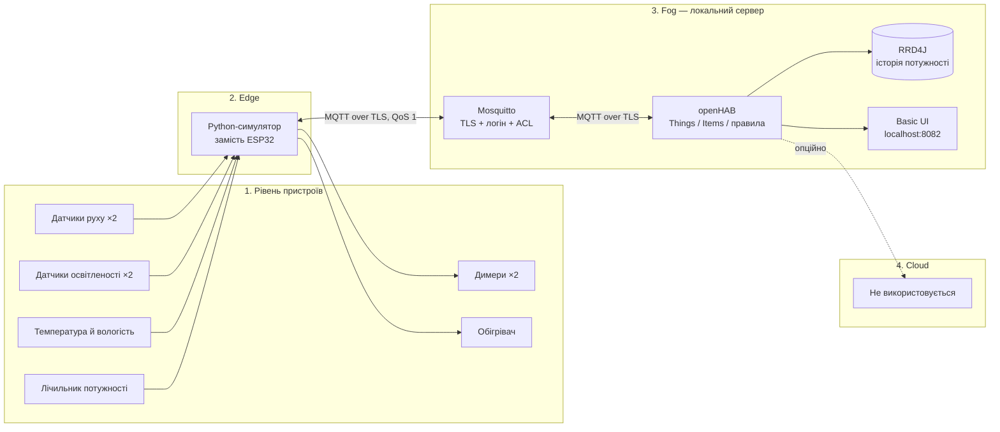

# IoTModul — енергоощадна розумна квартира

**🎥 Відео-демонстрація:** [Google Drive](https://drive.google.com/file/d/1terM_T5w8lPhlQCMZSpQStu_QdBaRDHZ/view?usp=sharing)

**Варіант 1 — «Енергоощадна розумна квартира».** Система для квартири з двома кімнатами (вітальня й спальня):

- вмикає світло лише там, де є рух і темно, та вимикає його, коли руху немає;
- переходить в економний режим обігріву, коли вдома нікого немає;
- стежить за споживаною потужністю й вимикає обігрівач у разі тривалого перевантаження мережі;
- показує панель керування українською та графік потужності за останню годину.

Фізичні ESP32, датчики й актуатори не під'єднані — їх замінює локальний Python-симулятор, який працює за тими самими MQTT-темами, що й реальні пристрої.

## Архітектура



Детальніше про компоненти — у [docs/architecture.md](docs/architecture.md).

### Пристрої

| Пристрій | Кількість | Тип | Що робить | MQTT-тема (префікс `iotmodul/`) |
| --- | --- | --- | --- | --- |
| Датчик руху (PIR) | 2 | датчик | рух у вітальні / спальні, `ON`/`OFF` | `living/motion/state`, `bedroom/motion/state` |
| Датчик освітленості | 2 | датчик | освітленість кімнати, лк | `living/lux/state`, `bedroom/lux/state` |
| Датчик клімату | 1 | датчик | температура, °C, і вологість, % | `climate/temperature/state`, `climate/humidity/state` |
| Лічильник потужності | 1 | датчик | споживана потужність квартири, Вт | `power/state` |
| Димер світла | 2 | актуатор | яскравість 0–100 % | `living/light/set` → `living/light/state` (так само `bedroom/…`) |
| Обігрівач | 1 | актуатор | увімкнення / вимкнення, уставка | `heater/set`, `heater/setpoint/set` → `…/state` |

### Де обробляються дані: edge, fog чи хмара

- **Edge (пристрій / ESP32).** Лише збирає показники й виконує команди. Логіки автоматизації тут немає: якщо змінити правило, не доведеться перепрошивати кожен пристрій.
- **Fog (локальний сервер з Docker).** Тут уся обробка: брокер Mosquitto, правила openHAB, таймери, історія RRD4J і панель. Рішення ухвалюються за мілісекунди, система працює без інтернету, а дані про присутність мешканців не залишають квартиру — для розумного житла це питання приватності.
- **Cloud.** Не використовується. Для однієї квартири хмара не дає переваг, але додає залежність від інтернету, затримку й ризик витоку даних. За потреби віддаленого доступу її можна під'єднати до openHAB (наприклад, myopenHAB), не змінюючи нижні рівні.

### Чому MQTT, а не CoAP, HTTP, Zigbee чи LoRaWAN

Для квартири потрібен протокол, який працює через уже наявний Wi-Fi, доставляє події миттєво й дає змогу кільком клієнтам бачити ті самі дані. MQTT підходить найкраще: модель publish/subscribe розв'язує датчики й openHAB, QoS 1 гарантує доставку команд, retained-повідомлення одразу дають новому клієнту останній стан, Last Will повідомляє про зникнення пристрою, а TLS, паролі та ACL на брокері закривають безпеку; ESP32 підтримує MQTT нативно, openHAB — через стандартний binding. HTTP потребує постійного опитування (polling) і не має push-повідомлень; CoAP розрахований на UDP і дуже обмежені пристрої, має слабшу підтримку в openHAB і складніше захищається (DTLS); Zigbee вимагає окремого координатора й радіомережі, а LoRaWAN призначений для кілометрових відстаней із повідомленнями раз на хвилини — для квартири з частими оновленнями (кожні 2 с) і миттєвим керуванням світлом він надлишковий і занадто повільний.

## MQTT-теми

Префікс — `iotmodul/`. Стани передаються з QoS 1 і як retained, команди — QoS 1 без retained.

| Тема | Напрямок | Дані |
| --- | --- | --- |
| `living/motion/state`, `bedroom/motion/state` | симулятор → openHAB | рух `ON`/`OFF` |
| `living/lux/state`, `bedroom/lux/state` | симулятор → openHAB | освітленість, лк |
| `climate/temperature/state` | симулятор → openHAB | температура, °C |
| `climate/humidity/state` | симулятор → openHAB | вологість, % |
| `power/state` | симулятор → openHAB | потужність, Вт |
| `living/light/set`, `bedroom/light/set` | openHAB → симулятор | команда яскравості 0–100 |
| `living/light/state`, `bedroom/light/state` | симулятор → openHAB | фактична яскравість |
| `heater/set` / `heater/state` | openHAB ↔ симулятор | команда / стан обігрівача |
| `heater/setpoint/set` / `heater/setpoint/state` | openHAB ↔ симулятор | уставка температури |
| `demo/overload/set` / `demo/overload/state` | openHAB ↔ симулятор | тест перевантаження (2700 Вт) |
| `demo/away/set` / `demo/away/state` | openHAB ↔ симулятор | демо «Нікого вдома» |
| `status/simulator`, `status/openhab` | клієнт → брокер | `ONLINE` / `OFFLINE` (birth і Last Will) |

ACL: openHAB читає `…/state` і пише `…/set`, симулятор — навпаки. Деталі — у [docs/mqtt.md](docs/mqtt.md).

## Правила автоматизації

Файл: [openhab/conf/rules/smart-flat.rules](openhab/conf/rules/smart-flat.rules).

| № | Правило | Умова | Дія |
| --- | --- | --- | --- |
| 1 | Світло за рухом | рух у кімнаті й освітленість < 50 лк | світло цієї кімнати на 70 %; таймер 5 хв без руху — світло вимикається; якщо стало світло (≥ 50 лк) — вимикається одразу |
| 2 | Порожня квартира | немає руху в обох кімнатах 30 хв (у демо-режимі — 30 с) | економний режим, уставка 17 °C |
| 2a | Присутність | будь-який рух | економний режим вимикається, уставка 21 °C |
| 3 | Захист від перевантаження | потужність > 2500 Вт довше 1 хв (коротші стрибки ігноруються) | сповіщення «УВАГА…», режим «Перевантаження», обігрівач примусово вимкнено; коли потужність повертається в норму — сповіщення «Норма» |
| — | Термостат | температура нижча / вища за уставку | обігрівач вмикається / вимикається; під час перевантаження тримається вимкненим |

## Запуск

Потрібен Docker Desktop із Docker Compose.

1. Склонуйте репозиторій і перейдіть у теку:

   ```powershell
   git clone https://github.com/TralalelaTralala/IoTMODUL.git
   cd IoTMODUL
   ```

2. Створіть файл із паролями (він виключений з Git) і замініть обидва значення на різні довгі паролі:

   ```powershell
   Copy-Item .env.example .env
   notepad .env
   ```

3. Запустіть систему:

   ```powershell
   docker compose up -d --build
   ```

   Спочатку стартує Mosquitto; коли він стає `healthy`, запускаються openHAB і симулятор. Перший запуск генерує локальний TLS CA і сертифікат брокера в Docker volumes. openHAB завантажується ~30 с.

4. Відкрийте [панель квартири](http://localhost:8082/basicui/app?sitemap=smartflat). Адмін-панель openHAB — [localhost:8082](http://localhost:8082) (під час першого входу створіть адміністратора).

Усі порти прив'язані лише до `127.0.0.1`: MQTT/TLS — `8884`, openHAB — `8082`/`8444`.

### Демонстрація

- **Економ-режим:** у панелі увімкніть «Демо: нікого вдома» — за 30 с увімкнеться економний режим (17 °C). Вимкніть перемикач — з'явиться рух і повернеться 21 °C.
- **Перевантаження:** увімкніть «Тест перевантаження» — потужність стане 2700 Вт, за хвилину з'явиться сповіщення й обігрівач вимкнеться. Після показу вимкніть тест.
- **Журнал безпеки брокера:**

  ```powershell
  docker compose logs -f mosquitto | Select-String "Denied|not authorised|Protocol error"
  ```

### Керування

```powershell
docker compose ps                # стан контейнерів
docker compose logs -f openhab   # журнал openHAB
docker compose down              # зупинити (дані й ключі лишаються у volumes)
docker compose down -v           # зупинити й видалити дані та TLS-ключі
```

## Безпека

- Анонімний доступ до брокера вимкнено; лише TLS, логін і пароль.
- openHAB і симулятор мають окремі облікові записи; ACL за принципом найменших привілеїв.
- Паролі — лише в локальному `.env`; сертифікати й ключі генеруються в Docker volumes і не потрапляють у Git.
- Порти відкриті лише на loopback; хмарного з'єднання немає.

Модель загроз STRIDE і залишкові ризики — у [docs/threat-model-stride.md](docs/threat-model-stride.md). Це навчальна система, не production; penetration test не виконувався.

## Структура репозиторію

```
docker-compose.yml        — три сервіси: mosquitto, openhab, simulator
mosquitto/                — конфігурація брокера, ACL, генерація TLS і паролів
openhab/conf/             — things, items, rules, sitemaps, persistence
simulator/simulator.py    — симулятор датчиків і актуаторів
docs/                     — архітектура, MQTT, модель загроз STRIDE
AI_USAGE.md               — звіт про використання ШІ
```
