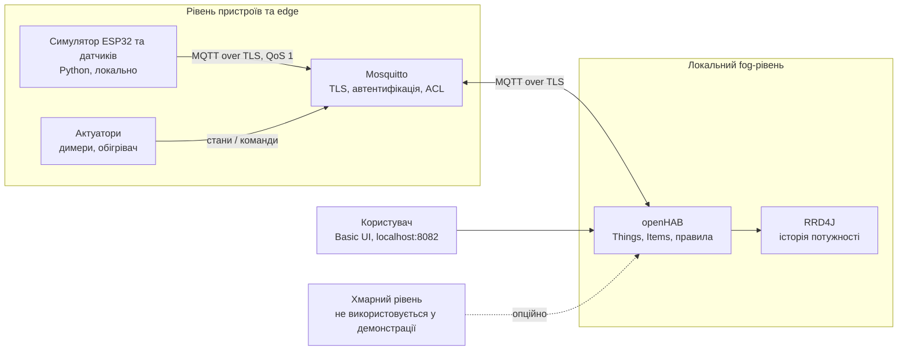

# Архітектура IoTModul

## Компоненти та потоки даних

| Рівень | Вузол | Функція |
| --- | --- | --- |
| Пристрій/edge | Python-симулятор | Генерує рух, освітленість, клімат і потужність; приймає команди димерів та обігрівача. У реальній системі тут працював би ESP32 або шлюз датчиків. |
| Fog | Mosquitto | Локальний брокер. Вимагає логін і пароль, перевіряє ACL, шифрує транспорт TLS. Порт хоста прив'язаний лише до loopback. |
| Fog | openHAB | Збирає стани в Things/Channels/Items, виконує правила автоматизації, віддає Basic UI. |
| Fog | RRD4J | Зберігає часовий ряд потужності та віддає годинний графік. |
| Cloud | Відсутній | Дані не відправляються у хмару; зовнішня залежність не потрібна для демонстрації. |

Фізичні пристрої не під'єднані: значення генерує локальний симулятор. Усі дані та конфігурації проєкту зберігаються в цій теці; runtime-томи Docker є локальними.
